*Tôi tạo ra sản phẩm công nghệ, đôi khi tạo luôn sự cố.*

## About

<table>
  <tr>
    <td width="60%" valign="top">
      
Mình là <b>Hiền</b>, sinh viên CNTT tại Đại học Giao thông vận tải TP.HCM, đang đi trên con đường trở thành <b>Full-stack Developer</b>.

      
Mình mê AI và thích làm ra những sản phẩm có thể dùng được thật, từ tiện ích trình duyệt đến ứng dụng desktop và Android. Hơi nhiều bug trên đường đi, nhưng bug cũng là bài học miễn phí.

    </td>
    <td width="40%" valign="top">
      <b>Địa điểm</b> TP. Hồ Chí Minh, Việt Nam  
      <b>Định hướng</b> Full-stack Development  
      <b>Ngôn ngữ</b> Tiếng Việt, Tiếng Anh  
      <b>Cách học</b> <code>Build → Break → Debug → Improve</code>
    </td>
  </tr>
</table>

## Tech Stack

<table>
  <tr>
    <td width="50%" valign="top">
      <b>PROGRAMMING LANGUAGES</b>  
      
    </td>
    <td width="50%" valign="top">
      <b>FRAMEWORKS &amp; DEVELOPMENT</b>  
       + Jetpack Compose
    </td>
  </tr>
  <tr>
    <td width="50%" valign="top">
      <b>DATABASE &amp; BACKEND</b>  
       Xác thực và lưu trữ dữ liệu
    </td>
    <td width="50%" valign="top">
      <b>TOOLS &amp; PLATFORMS</b>  
      
    </td>
  </tr>
</table>

## Featured Projects

<table>
  <tr>
    <td width="50%" valign="top">
      
      <h3>VYRON</h3>
      YouTube Video Explanation · Chrome Extension MV3 · 2026 
      
      
Tự lấy phụ đề YouTube, dịch và đọc thành tiếng, chạy hoàn toàn trên máy người dùng.

      <ul><li>Tự điều chỉnh tốc độ đọc để khớp với video</li><li>Debug Panel chỉ rõ lỗi ở bước nào</li><li>129 automated tests</li></ul>
      
      
<a href="https://github.com/hiennam2803/Vyron">Repository</a> · <a href="https://github.com/hiennam2803/Vyron/releases/tag/v0.6.5">Release v0.6.5</a>

    </td>
    <td width="50%" valign="top">
      
      <h3>C.I.R.C.A</h3>
      AI Workspace Desktop Application · 2026 
      
      
Gom ChatGPT, Claude và Gemini vào một cửa sổ, giữ ngữ cảnh theo từng dự án.

      <ul><li>Ghim ngữ cảnh cho từng dự án</li><li>Tạo prompt để tiếp tục công việc ở phiên AI mới</li><li>Giao diện đen và lavender, panel kéo đổi kích thước</li></ul>
      
      
<a href="https://github.com/hiennam2803/C.I.R.C.A">Repository</a>

    </td>
  </tr>
  <tr>
    <td width="50%" valign="top">
      
      <h3>Salud</h3>
      Health Management Application · 2025 
      
      
Theo dõi sức khỏe, dinh dưỡng, vận động và giấc ngủ ở cùng một nơi.

      <ul><li>Trợ lý AI gợi ý sức khỏe, ăn uống, luyện tập</li><li>Kiến trúc MVVM</li><li>Firebase cho xác thực và lưu trữ</li></ul>
       + Jetpack Compose
      
<a href="https://github.com/uthprj/Salud_App">Repository</a> · <a href="https://hiennam2803.github.io/Salud_download_web/">Demo</a>

    </td>
    <td width="50%" valign="top">
      
      <h3>WIIS</h3>
      Why, It Is Sunday? · 2026 
      
      
Quản lý lịch học, lịch thi và sự kiện của sinh viên trong một nơi.

      <ul><li>Đồng bộ thời khóa biểu và nhắc lịch</li><li>MVVM và Repository Pattern</li><li>Xem lịch theo ngày và theo tháng</li></ul>
       + Jetpack Compose
      
<a href="https://github.com/hiennam2803/WIIS">Repository</a>

    </td>
  </tr>
</table>

## GitHub Analytics

## Currently Exploring

<table>
  <tr>
    <td><code>→</code> AI-powered development workflow</td>
    <td><code>→</code> Local context management</td>
    <td><code>→</code> Electron desktop applications</td>
  </tr>
  <tr>
    <td><code>→</code> Android application architecture</td>
    <td><code>→</code> Full-stack development</td>
    <td></td>
  </tr>
</table>

## Terminal

## Connect

 

**Không hứa hoàn hảo, chỉ hứa sửa đến khi chạy.**

