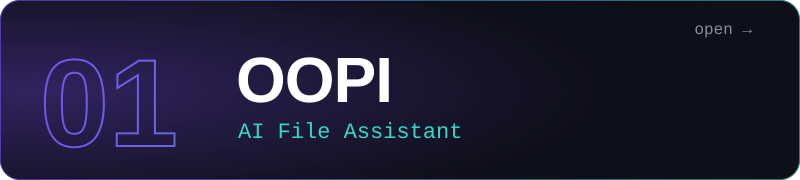
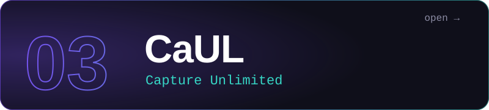
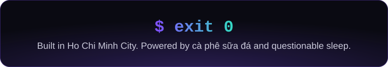

  

  IT student in <b>Ho Chi Minh City</b>. Started coding in 2023, and have been saying "just one more feature" ever since. 
  Into software engineering, AI, Android, desktop apps, and automating anything I'm too lazy to do twice.

## Selected work

Three projects I'm happy to be judged by.

<!-- TODO: replace the three links below with the exact repo URLs, e.g. https://github.com/hiennam2803/<repo-name> -->

An AI assistant for your files, built on the radical belief that `final_v2_REAL_final.docx` is not a filing system.

Watch foreign-language videos without playing tennis between the picture and the subtitles. VYRON is a Chrome extension that grabs YouTube subtitles, translates them into Vietnamese and reads them aloud, in sync with the video. It all runs in the browser: no server, no bill.

`TypeScript` · `Vite` · `Manifest V3` · `129 automated tests`

The name promises no limits. Bold of it.

## Stack

| | |
|---|---|
| **Languages** | `Python` · `Kotlin` · `C++` · `TypeScript` |
| **Frameworks** | `Jetpack Compose` · `Electron.js` |
| **Tools** | `Android Studio` · `VS Code` · `GitHub` |

Not listed: staring at error messages until they blink first.

## Receipts

Auto-generated from my public repos, so even I can't exaggerate.

  
  

  

